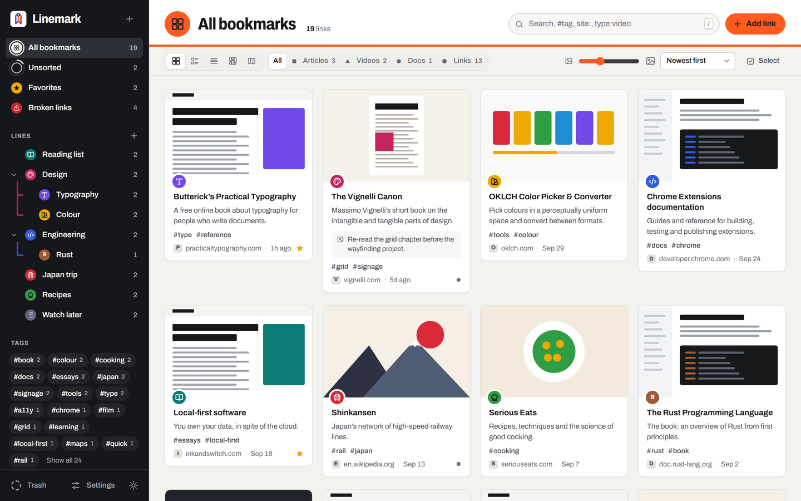
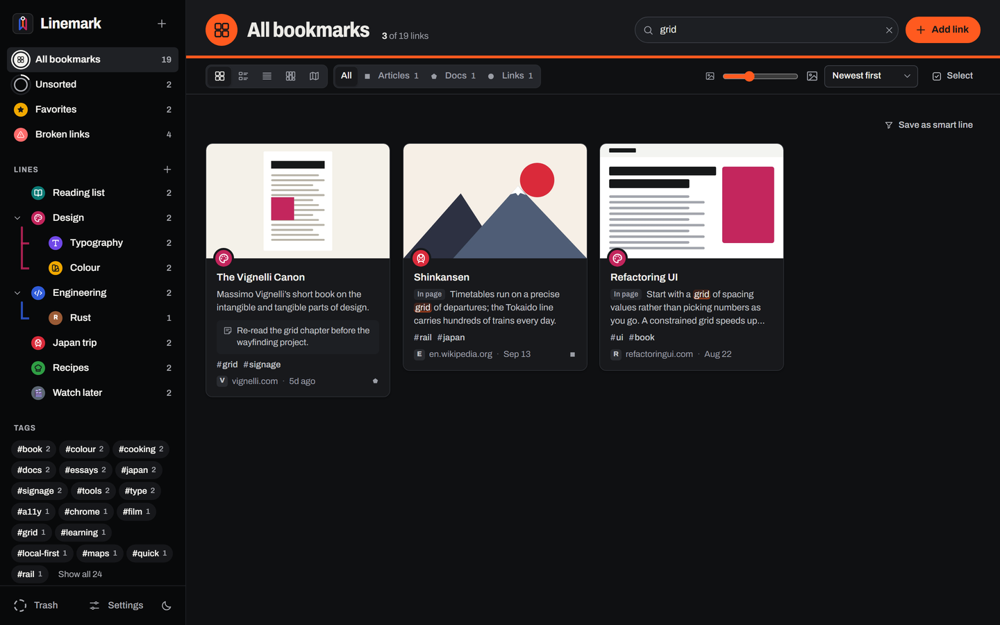
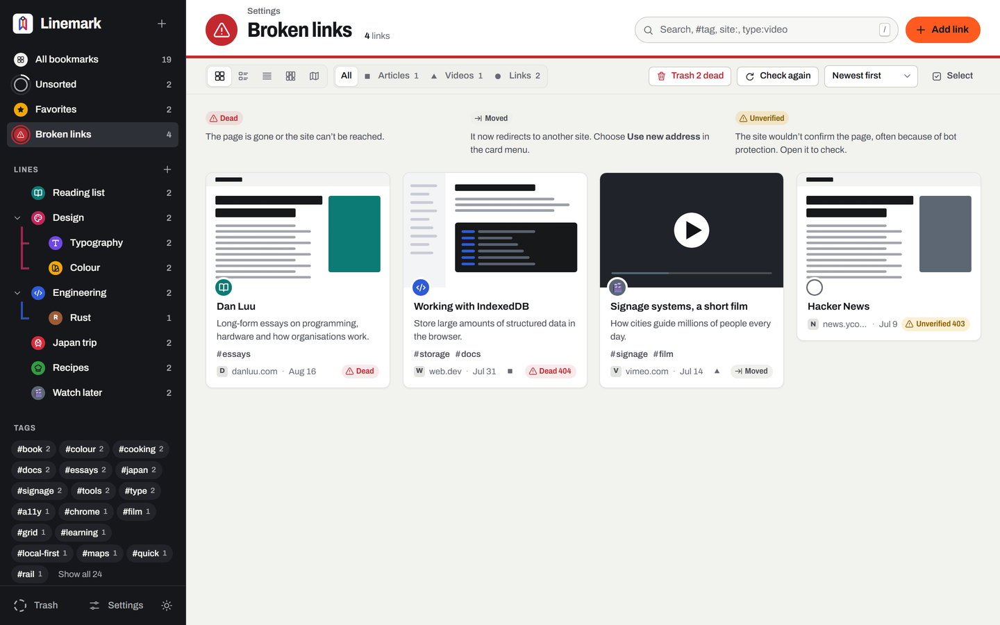
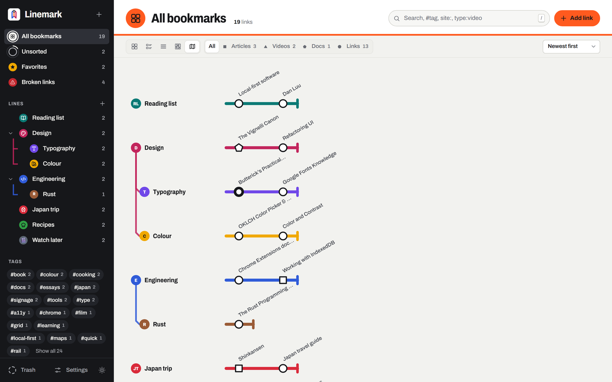

<p align="center"></p>

<h1 align="center">Linemark</h1>

<p align="center"><b>A bookmark manager drawn like a transit map, that keeps your library on your own computer.</b></p>

<p align="center">
  <a href="https://github.com/EY4O/linemark/blob/main/LICENSE"></a>
  <a href="https://github.com/EY4O/linemark/commits/main"></a>
  <a href="https://chromewebstore.google.com/detail/laapaiiaipeoilipnbhpjmjbdkomhjln"></a>
  <a href="https://microsoftedge.microsoft.com/addons/detail/linemark-%E2%80%94-bookmark-manag/dmcbfeidokchcjodabdggmgjcjmebbdg"></a>
  <a href="https://ko-fi.com/looneth"></a>
</p>

Linemark is a browser extension for people who save a lot of links and want to find them again. Each collection is a colour-coded **line**, like on a transit map, with branches for sub-collections. It searches the words inside every page you save and checks your links for you. There's no account and no server: your library lives in your browser, with optional encrypted sync through your own Google Drive. Install it from the [Chrome Web Store](https://chromewebstore.google.com/detail/laapaiiaipeoilipnbhpjmjbdkomhjln) or [Microsoft Edge Add-ons](https://microsoftedge.microsoft.com/addons/detail/linemark-%E2%80%94-bookmark-manag/dmcbfeidokchcjodabdggmgjcjmebbdg); Brave, Vivaldi and other Chromium browsers use the Chrome Web Store. More on the [homepage](https://linemark.eternalpose.io/).



---

## ✨ Key Features

- 🚇 **Lines and branches** — colour-coded collections that nest; type `Cooking/Baking` in any line picker to make a branch as you file, and let a link stop on several lines at once.
- ⚡ **Save in one gesture** — the toolbar button, **Alt+Shift+S** or the right-click menu saves the page with its title, description and cover, straight to **Unsorted**.
- 🖍️ **Highlights and images** — right-click selected text to keep it with its page, or an image to save it with the page it came from.
- 🔎 **Find anything again** — search the text of every page you save and see the passage that matched, filter with `#tag`, `site:` or `type:`, or search from the address bar with `lm`.
- 🩺 **Keep links healthy** — the link checker sorts dead, moved and unverified links, with one-click fixes and the Internet Archive's copy of a dead page.
- 🗺️ **Five views** — cards, list, headlines, a moodboard, and a network map that draws your library as a transit map.
- 🎨 **Make it yours** — give a line a site's logo (Reddit, GitHub, YouTube…), one of 240 icons or any emoji, and recolour lines after a city's transit map or in a colour of your own.
- 🔐 **Private by default** — no account, no server, no tracking; optional sync goes encrypted (AES-256) to your own Google Drive and keeps Chrome and Edge in step.

## 📸 Screenshots

| | |
|---|---|
|  **Full-text search** — finds the word inside saved pages and shows the passage that matched |  **Broken links** — dead, moved and unverified links, each with a fix |
|  **Network map** — every link a station in the shape of its kind, on its lines |  **Popup** — saves the page as it opens, then lets you pick a line, tags, a note and a cover |

<sub>Screenshots use a demo library of real public sites. The cover images are drawings standing in for page screenshots.</sub>

---

## 📦 Installation

### Option 1: **From your browser's store** (Recommended)

- **Chrome, Brave, Vivaldi and other Chromium browsers:** [Linemark on the Chrome Web Store](https://chromewebstore.google.com/detail/laapaiiaipeoilipnbhpjmjbdkomhjln) → **Add to Chrome**.
- **Microsoft Edge:** [Linemark on Microsoft Edge Add-ons](https://microsoftedge.microsoft.com/addons/detail/linemark-%E2%80%94-bookmark-manag/dmcbfeidokchcjodabdggmgjcjmebbdg) → **Get**.

Store copies update themselves.

### Option 2: **Manual Installation**

```bash
git clone https://github.com/EY4O/linemark.git
```

1. Open `chrome://extensions` (or `edge://extensions`) and turn on **Developer mode**.
2. Click **Load unpacked** and choose the folder that contains `manifest.json`.
3. Pin Linemark from the puzzle-piece menu so the toolbar button stays visible.

There is no build step and no dependencies.

<details>
<summary><b>Updating an unpacked copy</b></summary>

Replace the files (or `git pull`), then click the reload arrow on Linemark's card in `chrome://extensions`. Your bookmarks are kept: they live in the extension's storage, not in the folder. An unpacked copy has a different extension ID from the store copy, so the two keep separate libraries.
</details>

## 🚀 Getting Started

1. After installing, Linemark opens its library. Click **Import Chrome bookmarks** (in Edge, **Import Edge favorites**): your folders become lines.
2. On any page, click the Linemark toolbar button or press **Alt+Shift+S**. The page is saved to **Unsorted** straight away.
3. In the popup, click the line name to file it, add tags, or pick **Page**, **Screen** or **None** for the cover.
4. Open the library with **Alt+Shift+L**. Drag links from **Unsorted** onto lines, and use a line's **⋯** menu to rename it, recolour it, pick an icon or add a branch.
5. Search with **/** in the library, or type `lm`, then Space, in the address bar.

---

## 📖 How It Works

<details>
<summary><b>💾 Where your data lives</b></summary>

- Bookmarks, lines, covers and page text are stored in the extension's **IndexedDB**, inside your browser profile. The `unlimitedStorage` permission stops the browser from evicting them.
- Nothing is uploaded unless you turn on sync. If you remove the extension, the browser deletes this data, so use **Settings → Take links out → Full backup (JSON)** first if you want to keep it.
- Removing the extension doesn't touch your browser's own bookmarks. Linemark only reads them when you import.
</details>

<details>
<summary><b>🖼️ How previews are made</b></summary>

- **Saving from the toolbar or right-click menu:** Linemark reads the page's own title, description and cover image (`og:image`) from the open tab, and takes a downscaled screenshot. The cover is **downloaded once and stored** (shrunk to about 960px, WebP). You can switch between the two in the popup.
- **The library never hot-links.** Cards load covers from local storage only. A cover that still points at a website, for example from an HTML import, shows a placeholder until you store it from **Settings → Health & search → Covers not stored yet**.
- **Imported links** have no preview at first. Under **Settings → Health & search → Missing previews**, the browser asks once for permission to read sites; Linemark then requests each saved page, four at a time, and reads the same details.
- **Fetching other sites** happens in the extension's service worker, never in the library page, so a site's own preload headers can't load its scripts or styles into Linemark.
- Site icons come from the browser's local favicon cache (the `favicon` permission). No icon service is used.
</details>

<details>
<summary><b>🩺 Link checking and full-text search</b></summary>

- **Settings → Health & search** starts a check. Each link costs one request, and that response is used three ways: to record whether the link works, to keep the page's readable text (scripts, navigation and footers stripped, up to 20,000 characters), and to fill in a missing preview.
- **Dead** means 404 or 410, or the site couldn't be reached. **Moved** means it works but now redirects to another site; **Use new address** in the card's menu updates it. **Unverified** means the site answered but wouldn't confirm the page (403, 429, a server error or a timeout), often bot protection, so Linemark never treats it as dead.
- If the first eight sites can't be reached at all, Linemark stops: it assumes your connection is down rather than marking your library dead.
- On a dead link, **Find archived copy** asks the Internet Archive for its most recent snapshot.
- Pages saved from the toolbar or right-click menu are indexed straight away, with no extra request.
</details>

<details>
<summary><b>🔐 Optional encrypted sync</b></summary>

- **Off by default.** Turn it on in **Settings → Sync**.
- **Where it goes:** your own Google Drive's hidden app folder, which your other files and other apps can't see. Chrome and Edge share it, so one library follows you across both.
- **How it's protected:** your passphrase goes through PBKDF2-SHA256 (600,000 iterations) to make an AES-256-GCM key, created on your device and never exported. Google only stores ciphertext, and a forgotten passphrase can't be recovered.
- **What syncs:** lines, bookmarks, deletions and stored images. Each device rebuilds its own search index.
- **Sign-in:** one click in Chrome (the account Chrome is signed into), or Google's sign-in window in Edge, Brave and Vivaldi. Setting up your own build is described in **[docs/SYNC.md](docs/SYNC.md)**.
</details>

<details>
<summary><b>🔐 Permissions, and why</b></summary>

| Permission | Used for |
|---|---|
| `activeTab`, `scripting` | Reading the title, description, cover and text of the page you're saving, and taking its screenshot |
| `contextMenus` | **Save page**, **Save link**, **Save highlight** and **Save image to Linemark** on right-click |
| `bookmarks` | One-click import of your browser's bookmarks (read only) |
| `favicon` | Site icons from the browser's own cache |
| `storage`, `unlimitedStorage` | Keeping your library, covers and page text locally |
| `tabs`, `tabGroups` (optional) | **Save all open tabs**, saving tab groups as lines, and opening a line as a tab group |
| Site access (optional) | Link checks, page text, previews for imported links, **Refresh**, and the Internet Archive lookup |
| `identity` (optional) | Signing in to Google for sync; never requested while sync is off |

Optional permissions are asked for only when you use the feature that needs them.
</details>

<details>
<summary><b>🎨 Line icons, logos and colours</b></summary>

- A line's bullet shows its letters, one of 240 [Lucide](https://lucide.dev) icons, one of 72 site logos from [Simple Icons](https://simpleicons.org), or any emoji. One search in **Icon or emoji…** covers sites and icons. Logos are drawn in the bullet's ink, never in the brand's own colours.
- Lines take one of twelve colours from the current city palette (**Settings → Appearance → Line colours**: Linemark, London, Paris, Tokyo, New York, Berlin, Seoul) or any colour from the browser's colour picker. Switching palettes recolours palette colours and leaves custom ones as they are.
- Bundled icons and logos ship with the extension and load only when a line uses one, so nothing is fetched to draw them.
</details>

<details>
<summary><b>🔎 Search syntax</b></summary>

| Type | Finds |
|---|---|
| `kyoto rail` | Links whose title, address, description, note, tags, highlights or page text contain both words |
| `#rust` | Links tagged `rust`, or with a tag that starts with it |
| `site:github.com` | Links on that site |
| `type:video` | Videos. Also `article`, `image`, `document`, `link` |
| `is:fav` | Favorites |
| `has:note`, `has:highlights` | Links with a note, or with saved highlights |
| `is:broken` | Links that are dead, moved or unverified |

Search applies to the line or view you're in; **Search all bookmarks** widens it. **Save as smart line** keeps a search as a line that fills itself.
</details>

<details>
<summary><b>⌨️ Keyboard shortcuts</b></summary>

| Key | Action |
|---|---|
| Alt+Shift+S | Save the current page (anywhere in the browser) |
| Alt+Shift+L | Open the Linemark library |
| `/` or Ctrl+K | Search |
| N | Add a link |
| 1 – 5 | Cards, List, Headlines, Moodboard or Map |
| Arrow keys | Move between links |
| E / F / Space | Edit, favorite, or select the focused link |
| Ctrl+A, Del | Select all, or move the selection to Trash |
| F2 | Rename the focused line |
| Esc | Close the drawer, then clear the selection, then the search |

Change the global shortcuts at `chrome://extensions/shortcuts` (or `edge://extensions/shortcuts`).
</details>

---

## 🧪 Development

Tests, the project layout, packaging and store submission are described in **[docs/DEVELOPMENT.md](docs/DEVELOPMENT.md)**. Run the suite with `node tests/run.mjs` (needs Chrome, no packages).

## 🤝 Contributing

Issues and pull requests are welcome. Please run `node tests/run.mjs` and try the popup, the library and an import in a loaded copy before opening a PR.

## 🙏 Credits

- [Lucide](https://lucide.dev): the line-bullet icons (ISC licence, `icons/LUCIDE-LICENSE.txt`; the bundled set is in `tools/icon-list.txt`).
- [Simple Icons](https://simpleicons.org): the site logos (CC0, `icons/SIMPLE-ICONS-LICENSE.txt`; the bundled set is in `tools/brand-list.txt`). The logos remain their owners' trademarks.
- [Archivo](https://github.com/Omnibus-Type/Archivo) by Omnibus-Type, self-hosted from [Fontsource](https://fontsource.org/fonts/archivo) under the SIL Open Font License (`fonts/OFL.txt`).
- [Raindrop.io](https://raindrop.io/): the product that inspired Linemark's feature set ([comparison](COMPARISON.md)).
- The visual language borrows from International-style transit signage: line bullets, station signs and coloured route stripes.

## ☕ Support

If Linemark helps you keep your corner of the web in order, you can support its development:

[](https://ko-fi.com/looneth)

## 📄 License

[MIT](LICENSE). The bundled Archivo font (SIL Open Font License), Lucide icons (ISC) and Simple Icons logos (CC0) keep their own licences.
