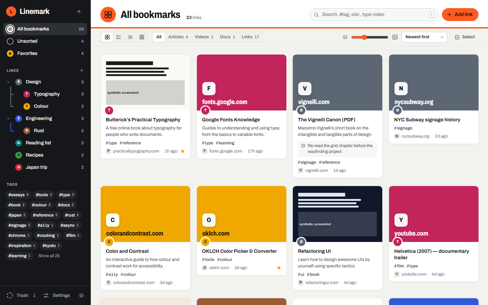
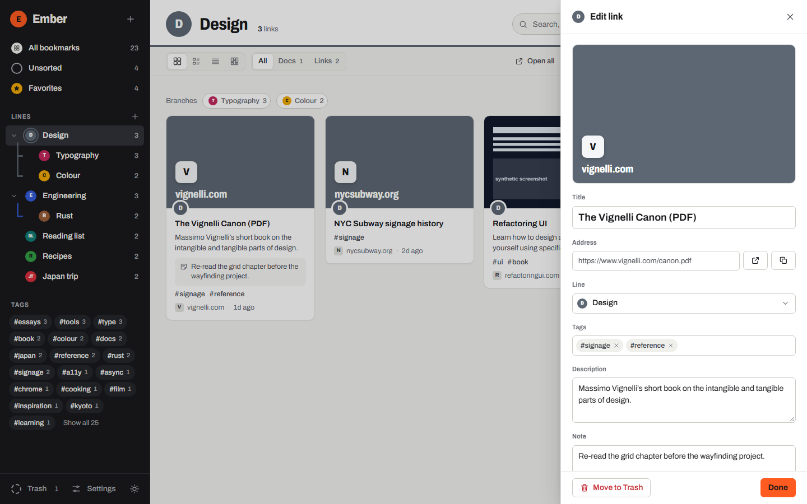
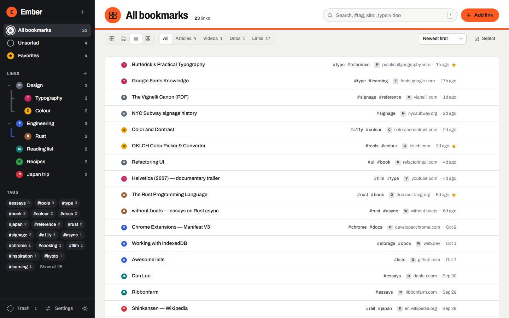
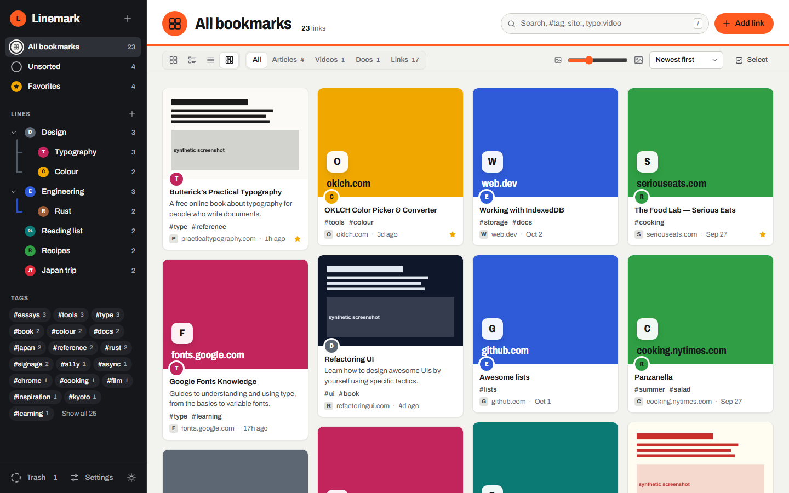
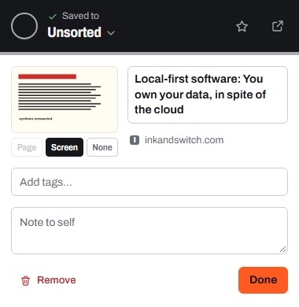

<p align="center"></p>

<h1 align="center">Linemark</h1>

<p align="center"><b>A Raindrop-style bookmark manager for Chrome that never leaves your machine.</b></p>

<p align="center">
  <a href="https://ko-fi.com/looneth"></a>
</p>

Linemark is a Chrome extension for people who save a lot of links and want to find them again. Each collection is a colour-coded **line**, like on a transit map, and lines can have branches. You can add tags, notes, covers and favorites, browse in four views, and search instantly. There's no account, no server and no subscription. Everything lives in your Chrome profile. Save from the toolbar, and organise in the full-page library tab.



---

## ✨ Key Features

- 🚇 **Lines and branches**: colour-coded collections that nest. Drag links onto a line to file them, or type `Cooking/Baking` in any line picker to make a branch as you file. A link can stop on several lines, like an interchange, and **smart lines** keep a search (`#tag`, `site:`, `is:fav`) as a line that fills itself.
- 🎨 **Line icons**: give each line's bullet one of 240 built-in icons (Lucide) or any emoji, chosen from a searchable picker in the line's menu.
- ⚡ **One-click save**: the popup saves the page as soon as it opens. Change the line, tags, note or cover afterwards.
- 🖍️ **Highlights and images**: select text and right-click **Save highlight to Linemark** (or open the popup with text selected) to keep the passage with its page; right-click any image to **Save image to Linemark**, stored on your computer with the page it came from. Search finds words in your highlights, and `has:highlights` lists the pages that have them. Where Chrome offers its built-in AI, the edit drawer can suggest a line, tags and a summary, worked out on your computer.
- 🖼️ **Real previews, stored locally**: each card shows the page's own cover image or a screenshot taken when you saved it. Both are downloaded once and kept on your computer, so browsing your library never loads anything from the web.
- 🔎 **Full-text search**: search titles, tags and notes, plus the text of the pages themselves. Results show the passage that matched. Filters include `#tag`, `site:`, `type:` and `is:fav`. You can also search from the address bar by typing `lm`, then Space.
- 🩺 **Broken link checker**: find dead, moved and unverified links. Update moved addresses in one click, point a dead link at its Internet Archive copy, or trash the dead ones all at once.
- 🗺️ **Five views**: Cards, List, Headlines, Moodboard, and a **network map** that draws your library as a transit map, with each link a station in the shape of its kind (○ link, ■ article, ▲ video, ⬟ document, ◆ image) and carriages running the lines.
- 🏙️ **City palettes**: recolour every line after London, Paris, Tokyo, New York, Berlin or Seoul in **Settings → Appearance**, and switch back any time. Unsorted fills up like a crowded platform, a ring sweeping round it as links wait to be filed.
- 📥 **Chrome import and tab groups**: bring in your whole Chrome bookmark tree in one click, or an HTML export from any browser, Raindrop or Pocket. Open a line as a tab group in its colour, or keep your tab groups as lines.
- 🕰️ **Departures board**: give a link a day to revisit, and it shows up on the board that day.
- 🎉 **Linemark Wrapped**: your year on the lines, from **Settings → Library**. **Summary** shows your busiest month, lines, tags and sites, and saves as a shareable image. **Journey** rides the year sideways: each month in big type, each saved page as a stop with its picture, and a dot that fills the line in each stop's colour as you scroll.
- 🧹 **Tidy-up tools**: a duplicate finder that merges tags and notes, bulk move and tag, a restorable Trash, and Undo on every change.
- 💾 **Your data, portable**: export Chrome-compatible HTML, or a full JSON backup that includes screenshots.
- 🔐 **Optional encrypted sync**: local by default. Turn on sync to keep Chrome, Edge, Brave and Vivaldi in step through your own Google Drive. Everything is encrypted on your device with your passphrase first, so Google only stores scrambled data.
- 🌗 **Light and dark**: follows your system setting, or set it yourself. An optional station chime (off by default) plays when you save from the toolbar or in the library.

## 📸 Screenshots

| | |
|---|---|
|  **Edit drawer**: change the title, line, tags, description and note. Every edit saves automatically |  **Headlines**: a dense, one-row-per-link view for scanning large libraries |
|  **Moodboard**: covers at their natural height, for visual collections |  **Quick-save popup**: saves the page when it opens, then lets you pick a line, cover and tags |

<sub>Screenshots use sample data. The "synthetic screenshot" covers are placeholders. In the real extension, covers come from the pages you save.</sub>

See [COMPARISON.md](COMPARISON.md) for a feature-by-feature comparison with Raindrop.io.

---

## 📦 Installation

### Option 1: **Load unpacked** (Recommended)

1. Download or copy this folder somewhere permanent. Chrome loads it from that location.
2. Open `chrome://extensions` and turn on **Developer mode** (top right).
3. Click **Load unpacked** and select the folder that contains `manifest.json`.
4. Pin Linemark from the puzzle-piece menu so the toolbar button is always visible.

### Option 2: **Other Chromium browsers**

Edge, Brave and Vivaldi accept the same folder through their own extensions page (`edge://extensions`, `brave://extensions`). This option is untested so far. Linemark is built and checked against Chrome.

### Option 3: **Manual Installation**

```bash
git clone <your-repo-url> orange
```

Then follow Option 1. There is no build step and no dependencies.

<details>
<summary><b>Updating</b></summary>

Replace the files in the folder, then click the reload arrow on Linemark's card in `chrome://extensions`. Your bookmarks are kept: they live in the extension's storage, not in the folder.
</details>

## 🚀 Getting Started

1. After installing, Linemark opens its library tab. Click **Import Chrome bookmarks**. Your folders become lines.
2. Browse to any page and click the Linemark toolbar button, or press **Alt+Shift+S**. The page is saved to **Unsorted** straight away.
3. In the popup, click the line name to file it, add tags, or choose **Page**, **Screen** or **None** for the cover.
4. Open the library with **Alt+Shift+L**. Drag links from **Unsorted** onto lines, and right-click a line to rename it, recolour it or add a branch.
5. Find anything with **/** in the library, or type **lm**, then Space, then your search in Chrome's address bar.

---

## 📖 How It Works

<details>
<summary><b>💾 Where your data lives</b></summary>

- Bookmarks, lines and cover screenshots are stored in the extension's **IndexedDB**, inside your Chrome profile. The `unlimitedStorage` permission stops Chrome from evicting them.
- Nothing is synced or uploaded. If you remove the extension, Chrome deletes this data. Use **Settings → Full backup (JSON)** first if you want to keep it.
- Removing the extension doesn't touch Chrome's own bookmarks. Linemark only reads them when you import.
</details>

<details>
<summary><b>🖼️ How previews are made</b></summary>

- **Saving from the toolbar or right-click menu:** Linemark reads the page's own title, description and cover image (`og:image`) from the open tab, and takes a downscaled screenshot. The cover image is **downloaded once and stored** with the screenshot (shrunk to about 960px, WebP). You can switch between the two in the popup.
- **The library never hot-links.** Cards load covers from local storage only. A cover that still points at a website, for example from an HTML import, shows the placeholder until you choose **Settings → Health & search → Store covers**.
- **Imported links:** these have no preview at first. Under **Settings → Health & search → Missing previews**, Chrome asks once for permission to read sites. Linemark then requests each saved page directly, four at a time, and reads the same metadata. You can revoke that access on the same screen.
- **Unused images:** when you remove or replace a cover, the old image is deleted. **Settings → Tidy up → Reclaim space** sweeps up anything left over.
- Favicons come from Chrome's local favicon cache (the `favicon` permission). No favicon service is used.
</details>

<details>
<summary><b>🩺 Link checking and full-text search</b></summary>

- Use **Settings → Health & search** to start a check. Linemark requests each saved page directly, four at a time, so each link costs one request. That single response is used three ways: to record whether the link works, to keep the page's readable text (scripts, navigation and footers are stripped, up to 20,000 characters), and to fill in any missing preview.
- **Dead** means the page returned 404 or 410, or the site couldn't be reached. **Moved** means the link works but now redirects to a different site; use **Use new address** in the card's menu to update it. **Unverified** means the site answered but wouldn't confirm the page (403, 429, a server error or a timeout). This is often bot protection, so Linemark never treats it as dead.
- If the first eight sites can't be reached at all, Linemark stops. It assumes your connection is down, rather than marking your whole library dead.
- Pages saved from the toolbar or right-click menu are indexed and marked as working straight away, with no extra request.
- The `is:broken` search filter finds links that need attention. Page text is stored in its own IndexedDB store and included in JSON backups.
</details>

<details>
<summary><b>🔐 Optional encrypted sync</b></summary>

- **Off by default.** Linemark never needs an account; sync is an extra you can turn on in **Settings → Sync**.
- **Where it goes:** your own Google Drive's hidden app folder, which your other files and other apps can't see.
- **How it's protected:** your passphrase goes through PBKDF2-SHA256 (600,000 iterations) to make an AES-256-GCM key. The key is created on your device and can't be exported. Google only stores ciphertext, and Linemark can't recover a forgotten passphrase.
- **What syncs:** lines, bookmarks, deletions and stored images. Each device rebuilds its own full-text index.
- **Setup:** click **Sign in with Google** (one click in Chrome, using the account Chrome is signed into) and choose a passphrase. A published build needs the publisher's one-time Google setup; until then, Settings lets you use your own free Google project. See **[docs/SYNC.md](docs/SYNC.md)**.
</details>

<details>
<summary><b>🔐 Permissions, and why</b></summary>

| Permission | Used for |
|---|---|
| `activeTab`, `scripting` | Reading the title, description and cover of the page you're saving, and taking its screenshot |
| `contextMenus` | **Save page to Linemark** and **Save link to Linemark** on right-click |
| `bookmarks` | One-click import of Chrome's bookmark tree (read only) |
| `favicon` | Showing site icons from Chrome's own cache |
| `storage`, `unlimitedStorage` | Keeping your library and screenshots locally |
| `tabs` (optional, asked for when needed) | **Save all open tabs** |
| Site access (optional, asked for when needed) | Link checking, indexing page text, fetching previews for imported links, and **Refresh** in the edit drawer |
| `identity` (optional, asked for when you set up sync) | Signing in to Google for encrypted sync. Never requested while sync is off |
</details>

<details>
<summary><b>🔎 Search syntax</b></summary>

| Type | Finds |
|---|---|
| `kyoto rail` | Links whose title, address, description, note, tags or indexed page text contain both words |
| `#rust` | Links tagged `rust`, or with a tag that starts with it |
| `site:github.com` | Links on that domain |
| `type:video` | Videos. Other types: `article`, `image`, `document`, `link` |
| `is:fav` | Favorites only |
| `has:note` | Links with a note |
| `is:broken` | Links that are dead, moved or unverified |

Search applies to the line or view you're in. Use **Search all bookmarks** to widen it to everything.
</details>

<details>
<summary><b>⌨️ Keyboard shortcuts</b></summary>

| Key | Action |
|---|---|
| Alt+Shift+S | Save the current page (works anywhere in Chrome) |
| Alt+Shift+L | Open the Linemark library |
| `/` or Ctrl+K | Search |
| N | Add a link |
| 1 – 4 | Cards, List, Headlines or Moodboard |
| Arrow keys | Move between links |
| E / F / Space | Edit, favorite, or select the focused link |
| Ctrl+A, Del | Select all, or move the selection to Trash |
| F2 | Rename the focused line in the sidebar |
| Esc | Close the drawer, then clear the selection, then clear the search |

You can change the global shortcuts at `chrome://extensions/shortcuts`.
</details>

---

## 🧪 Development

Run the test suite with `node tests/run.mjs` (needs Chrome, no packages). It covers the model, import/export, the library UI, keyboard access, link health, full-text search, local covers, and a fresh install of the real extension. The project layout is described in **[docs/DEVELOPMENT.md](docs/DEVELOPMENT.md)**.

## 🤝 Contributing

Issues and pull requests are welcome. Please load the extension unpacked and try the popup, the library and an import before opening a PR.

## 🙏 Credits

- [Lucide](https://lucide.dev): the line-bullet icons (ISC licence, `icons/LUCIDE-LICENSE.txt`). The bundled set is listed in `tools/icon-list.txt`.

- [Raindrop.io](https://raindrop.io/): the product that inspired Linemark's feature set.
- [Archivo](https://github.com/Omnibus-Type/Archivo) by Omnibus-Type, self-hosted from [Fontsource](https://fontsource.org/fonts/archivo) under the SIL Open Font License (`fonts/OFL.txt`).
- The visual language borrows from International-style transit signage: line bullets, station signs and coloured route stripes.

## ☕ Support

If Linemark helps you keep your corner of the web in order, you can support its development:

[](https://ko-fi.com/looneth)

## 📄 License

No license has been chosen yet. Add a `LICENSE` file before publishing. The bundled Archivo font is licensed separately under the SIL Open Font License.
